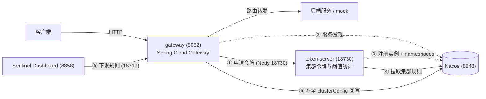

# Sentinel 集群流控实践

**Spring Cloud Gateway + 独立 Token Server + Nacos + Sentinel Dashboard**

单机限流只能管住单个实例：3 台网关、阈值 10，实际会放行 30 QPS。本项目把「令牌统计」从业务进程里抽出来做成独立的 **token-server**，网关作为 Token Client 申请令牌，阈值在**全局**生效；规则统一放在 Nacos，日常仍用 **Sentinel Dashboard** 管理，不需要改造控制台。

<p>
  
  
  
  
  
</p>

## 目录

- [解决什么问题](#解决什么问题)
- [架构](#架构)
- [模块说明](#模块说明)
- [技术栈](#技术栈)
- [快速开始](#快速开始)
- [关键设计](#关键设计)
- [配置速查](#配置速查)
- [观测与排障](#观测与排障)
- [目录结构](#目录结构)
- [生产落地清单](#生产落地清单)
- [版本兼容](#版本兼容)

## 解决什么问题

Sentinel 开源版的集群流控只提供「原语」，落地时有三个空白：

| 官方缺口 | 本项目的实现 |
| --- | --- |
| Token Server 没有服务发现，客户端只能写死 `host:port` | token-server 以临时实例注册到 Nacos，并把承载的 `namespaces` 写进实例 metadata；网关按 namespace 过滤后动态下发地址 |
| 集群规则是「namespace 维度」的，且必须带 `flowId` / `clusterConfig` | token-server 按 `{namespace}-flow-rules` 从 Nacos 拉规则；网关自动补全 `clusterMode` / `flowId` 并回写 |
| Dashboard 不支持编辑集群规则、也不生成 `flowId` | 在 Dashboard 上按普通流控规则操作（资源名填**路由 id**），网关收到后补全集群配置，token-server 1~2 秒内生效 |

额外补齐的两件事：

- **token-server 挂掉不背锅**：无可用实例时网关自动降级为本地限流，恢复后自动接管（见[关键设计](#关键设计)）；
- **多实例不会劈开阈值**：同一 namespace 的客户端按 `weight → IP → port` 稳定排序，永远选中同一个 token-server。

## 架构



规则流转时序：

1. Dashboard 编辑规则 → `POST /setRules?type=flow` 打到网关命令端口 `18719`；
2. 网关单线程合并：补全 `clusterMode=true` + `clusterConfig`（复用同 resource 的历史 `flowId`，新资源用 `crc32(resource)` 生成稳定值）；
3. 内容与 Nacos 不一致则回写 `api-gateway-flow-rules`；
4. token-server 收到 Nacos 推送 → `ClusterFlowRuleManager` 更新集群阈值；
5. 请求到达网关 → 向 token-server 申请令牌 → 超阈值直接返回 `429`。

## 模块说明

| 模块 | 角色 | 端口 | 说明 |
| --- | --- | --- | --- |
| [`token-server`](token-server/README.md) | 集群限流服务端 | 18730（Netty）/ 18731（管理）/ 18732（Sentinel 命令） | 独立部署，注册到 Nacos，按 namespace 从 Nacos 拉集群规则 |
| [`gateway`](gateway/README.md) | 限流客户端 | 8082（业务）/ 18719（Sentinel 命令） | WebFlux 网关，Token Client，负责规则补全与回写、Nacos 自注册、降级 |

## 技术栈

| 组件 | 版本 | 说明 |
| --- | --- | --- |
| Java | 17 | 两个模块均为 `spring-boot-starter-parent` 3.3.5 |
| Spring Cloud | 2023.0.3 | Gateway 4.1.x |
| Sentinel | 1.8.10 | `sentinel-core` + `sentinel-spring-cloud-gateway-adapter` + `sentinel-cluster-client-default` / `sentinel-cluster-server-default` |
| Nacos Client | 2.5.1 | Nacos 3.x 服务端必须 ≥ 2.5.x，否则报 `Code: 401, Message: User not found!` |
| Nacos Server | 3.3（实测） | 服务端口 `8848`，控制台默认 `8080` |
| Sentinel Dashboard | 1.8.10 | 独立 jar，端口 `8858`（避免和 Nacos 控制台的 8080 冲突） |

## 快速开始

> 下面的命令以 bash 为例；Windows PowerShell 把 `curl` 换成 `Invoke-WebRequest`、把 `for i in $(seq 1 10)` 换成 `1..10 | %{}` 即可。

### 0. 前置条件

- JDK 17、Maven 3.9+
- 已启动 Nacos（`localhost:8848`，开启鉴权时准备账号密码）
- `sentinel-dashboard-1.8.10.jar`（从 [Sentinel Releases](https://github.com/alibaba/Sentinel/releases) 下载，仓库不提交二进制）

### 1. 启动 Dashboard

```bash
java -Dserver.port=8858 \
     -Dcsp.sentinel.dashboard.server=localhost:8858 \
     -Dproject.name=sentinel-dashboard \
     -jar sentinel-dashboard-1.8.10.jar
```

默认账号 `sentinel` / `sentinel`。

### 2. 启动 token-server

```bash
cd token-server
mvn clean package -DskipTests
java -jar target/token-server-1.0.0.jar
```

启动成功标志：

```
[TokenServer] Namespace set prepared: [default, api-gateway, demo-app]
[TokenServer] Sentinel token server started, port=18730 ...
[TokenServer] Registered to Nacos successfully, ... instance=192.168.0.20:18730, metadata={namespaces=demo-app,api-gateway, ...}
```

校验：

```bash
curl http://localhost:18731/actuator/health
curl http://localhost:18731/token-server/info
```

### 3. 启动 gateway

```bash
cd gateway
mvn clean package -DskipTests
java -jar target/gateway-1.0.0.jar
```

校验（关键看 `cluster.state` 是否为 `CLUSTER_CLIENT`）：

```bash
curl http://localhost:8082/gateway-sentinel/info
```

```json
{
  "appName": "api-gateway",
  "nacos": { "registered": true, "serviceName": "sentinel-gateway", "address": "192.168.0.20:8082" },
  "cluster": {
    "enabled": true,
    "state": "CLUSTER_CLIENT",
    "tokenServerHost": "192.168.0.20",
    "tokenServerPort": 18730,
    "matchedInstanceCount": 1,
    "degraded": false,
    "degradeCount": 0
  },
  "rule": { "dataId": "api-gateway-flow-rules", "ruleCount": 1, "clusterRuleCount": 1 }
}
```

### 4. 建一条规则

**方式 A：Dashboard（推荐）**

1. 打开 `http://localhost:8858`，左侧应用列表出现 `api-gateway`；
2. 「流控规则」→ 新增：资源名填 **路由 id** `order-api`（不是 URL）、阈值类型 QPS、阈值 `3`；
3. 保存后 1~2 秒，规则会自动带上 `clusterMode` 并同步给 token-server。

**方式 B：直接写 Nacos**

`api-gateway-flow-rules` @ `SENTINEL_GROUP`（public 命名空间）：

```json
[{ "resource": "order-api", "limitApp": "default", "grade": 1, "count": 3, "strategy": 0, "controlBehavior": 0 }]
```

网关加载时会补全 `clusterConfig` 并回写，最终内容形如：

```json
[{
  "resource": "order-api", "limitApp": "default", "grade": 1, "count": 3.0,
  "clusterMode": true,
  "clusterConfig": { "flowId": 510296, "thresholdType": 0, "fallbackToLocalWhenFail": true, "sampleCount": 10, "windowIntervalMs": 1000 }
}]
```

### 5. 验证

```bash
for i in $(seq 1 10); do curl -s -o /dev/null -w "%{http_code} " http://localhost:8082/api/order; done
# 200 200 200 429 429 429 429 429 429 429
```

被限流时响应体：

```json
{ "code": 429, "message": "Too many requests, blocked by Sentinel", "path": "/api/order", "route": "order-api", "resource": "order-api" }
```

## 关键设计

### 1. 规则只有一个数据源

```
Nacos ({namespace}-flow-rules @ SENTINEL_GROUP)
  ├─► gateway   : NacosDataSource → ClusterRuleMerger 补全 → FlowRuleManager（本地生效）
  └─► token-server: ClusterFlowRuleManager（集群阈值）
```

网关在收到 Dashboard 下发的规则后**回写** Nacos，token-server 由此拿到同一份带 `clusterConfig` 的规则，所以 Dashboard 不用改造就能管理集群规则。

### 2. flowId 的生成与稳定性

- 已有 `clusterConfig` 的规则原样保留；
- 同一个 resource 复用上一次的 `flowId`，保证阈值连续；
- 全新 resource 用 `crc32(resource)` 生成，重启不变；
- 同一批规则内做去重，冲突时顺延。

### 3. 多实例不会劈开阈值

全局 QPS 是「一个 token-server 统计所有 client」，所以同一 namespace 的 client **必须连同一个实例**。`TokenServerDiscovery` 的排序规则是：

```
weight 倒序 → IP 升序 → port 升序
```

权重相同时选出同一个实例，避免两个网关各连一个 server 导致实际放行 2 倍。

### 4. token-server 挂了怎么办

无可用实例时，网关主动 `ClusterStateManager.applyState(CLUSTER_NOT_STARTED)` 切回本地限流，而不是一直向失效地址发请求等超时。实测（kill -9 token-server）：

| 阶段 | 状态 | 压测结果 |
| --- | --- | --- |
| 正常 | `CLUSTER_CLIENT` | `200 200 200 429×7` |
| kill 后 ~1s | `CLUSTER_NOT_STARTED`、`degraded=true`、`degradeCount=1`、`tokenServerHost=null` | `200 200 200 429×7`，10 次请求共 **59ms**（无超时惩罚） |
| 重启 token-server | 自动恢复 `CLUSTER_CLIENT`，日志 `recovered from local limiting after 21583ms` | `200 200 200 429×7` |

降级期间阈值语义为「每台 `count`」（`thresholdType=0` 单机均摊），不会放大流量；代价是失去全局统一阈值。

## 配置速查

完整配置见 [`gateway/README.md`](gateway/README.md) 与 [`token-server/README.md`](token-server/README.md)。

| 配置 | 默认值 | 说明 |
| --- | --- | --- |
| `server.port`（gateway） | 8082 | 网关端口 |
| `spring.application.name`（gateway） | `api-gateway` | 同时是集群 namespace，必须出现在 token-server 的 `namespace-set` |
| `sentinel.dashboard` | `127.0.0.1:8858` | 留空则不上报（不影响限流） |
| `sentinel.api-port` | 18719 | Dashboard 通过它下发规则 |
| `sentinel.cluster.service-name` / `group` | `sentinel-token-server` / `DEFAULT_GROUP` | token-server 在 Nacos 的坐标 |
| `sentinel.cluster.request-timeout` | 20（ms） | 申请令牌超时，跨机部署建议 50~100 |
| `sentinel.rule.data-id-pattern` | `{namespace}-flow-rules` | 必须与 token-server 一致 |
| `sentinel.rule.auto-cluster-enabled` | true | 自动补全 `clusterMode` / `clusterConfig` |
| `sentinel.rule.publish-enabled` | true | 把补全后的规则回写 Nacos |
| `sentinel.token-server.namespace-set` | `demo-app`、`api-gateway` | 承载的 namespace，启动时自动追加 `default` |
| `nacos.discovery.service-name` | `sentinel-gateway` / `sentinel-token-server` | 各自在 Nacos 的服务名 |

常用环境变量：

```bash
SERVER_PORT=8082
NACOS_SERVER_ADDR=localhost:8848
NACOS_USERNAME=nacos
NACOS_PASSWORD=***
NACOS_REGISTER_IP=192.168.0.20     # 多网卡机器必须显式指定，否则会注册成 WSL/Hyper-V 网段
SENTINEL_DASHBOARD=127.0.0.1:8858
SENTINEL_CLUSTER_NAMESPACE=api-gateway
SENTINEL_GATEWAY_NAMESPACE=api-gateway   # token-server 侧：网关的应用名
```

## 观测与排障

### 巡检接口

| 接口 | 用途 |
| --- | --- |
| `GET /gateway-sentinel/info` | 集群状态、token-server 地址、降级状态、规则数量与最近同步来源 |
| `GET /gateway-sentinel/rules` | 网关当前生效的规则（含 `clusterConfig`） |
| `GET /token-server/info` | 各 namespace 的集群规则数量、Nacos 注册状态 |
| `GET /actuator/health` | 探活 |

### 常见问题

| 现象 | 原因 | 处理 |
| --- | --- | --- |
| `state=CLUSTER_NOT_STARTED`、`matchedInstanceCount=0` | token-server 的 `namespace-set` 不含网关应用名，或 token-server 没启动 | 检查两边 namespace 是否一致；确认 `sentinel-token-server` 在 Nacos 里健康 |
| 规则保存了但 token-server 侧数量为 0 | 规则没有 `clusterMode=true`，或 dataId / group 不一致 | 确认 `auto-cluster-enabled=true`；核对 `{namespace}-flow-rules` 与 `SENTINEL_GROUP` |
| 网关重启后规则「看得见但没生效」 | Nacos 规则已带 `clusterConfig` 时启动加载曾跳过写入 `FlowRuleManager`（已修复） | 升级到当前版本；`/gateway-sentinel/info` 的 `ruleCount` 应等于 Nacos 里条数 |
| Dashboard 上看不到应用 | `sentinel.dashboard` 未配置、`18719` 被防火墙拦截 | 检查配置与端口；停服后 1~2 分钟从列表消失 |
| Nacos 报 `401 User not found` | nacos-client < 2.5.x 对接 Nacos 3.x | 升级 `nacos-client` 到 2.5.x |
| 注册 IP 是 `172.x`（WSL / Hyper-V） | 多网卡自动探测命中虚拟网卡 | 设置 `NACOS_REGISTER_IP`；本工程已优先选择内网 IPv4 并跳过虚拟网卡 |
| 限流阈值被放大 N 倍 | 多个 client 连到了不同 token-server | 保证同 namespace 的 client 选同一实例（`weight/IP/port` 排序已保证），或按 namespace 分片部署 |

## 目录结构

```
sentinel/
├── gateway/                     # 网关（Token Client）
│   ├── src/main/java/com/example/sentinel/gateway/
│   │   ├── cluster/             # Nacos 发现 token-server、降级/恢复
│   │   ├── config/              # sentinel.* / nacos.* 配置绑定
│   │   ├── discovery/           # 网关注册到 Nacos
│   │   ├── rule/                # 规则同步、clusterConfig 补全、回写
│   │   ├── sentinel/            # SentinelGatewayFilter / BlockHandler
│   │   └── web/                 # 巡检接口、mock 后端
│   └── README.md                # 网关详细文档
├── token-server/                # 集群限流服务端
│   ├── src/main/java/com/example/sentinel/tokenserver/
│   │   ├── core/                # Token Server 启停编排
│   │   ├── registry/            # 注册到 Nacos（含 IP 探测）
│   │   ├── rule/                # 按 namespace 拉取集群规则
│   │   └── web/                 # 巡检接口
│   └── README.md                # token-server 详细文档
└── README.md                    # 本文件
```

## 生产落地清单

这是**可运行的完整实践**，不是开箱即用的生产组件。上线前至少处理：

- [ ] **巡检接口收敛**：`/gateway-sentinel/*` 会暴露阈值与 token-server 内网地址，需挪到管理端口或加鉴权/内网白名单；
- [ ] **控制面安全**：Dashboard 默认口令 `sentinel/sentinel` 可改规则（等于能打挂业务），Nacos 密码不要明文进仓库；
- [ ] **超时标定**：`request-timeout` 按跨机 RTT 压测后调整（建议 50~100ms），并监控降级次数；
- [ ] **多实例选主**：已用 `weight → IP → port` 保证一致；若部署多个 token-server，请用**主备**（备机不注册）或**按 namespace 分片**，不要做同 namespace 双活；
- [ ] **可观测性**：接入 Prometheus（`/actuator/prometheus`）+ 告警（`degraded=true`、`degradeCount` 增长、token-server 断连）；
- [ ] **灰度**：新阈值先「只记录不拒绝」观察一周，再开真实拦截；
- [ ] **高可用**：网关多实例 + 前置 LB，探针走 `/actuator/health`；
- [ ] **规则治理**：变更审计、`flowId` 固定映射（避免 Dashboard 保存时重排）、多维度限流（API / 租户 / 用户）。

## 版本兼容

| 依赖 | 版本 | 备注 |
| --- | --- | --- |
| Sentinel | 1.8.10 | 集群流控相关 artifact：`sentinel-cluster-client-default` / `sentinel-cluster-server-default` / `sentinel-datasource-nacos` / `sentinel-transport-simple-http` |
| Nacos Server | 3.3 | 需要 nacos-client ≥ 2.5.x；配置 API 使用 `/nacos/v3/admin/cs/*` |
| Spring Boot | 3.3.5 | 未使用 `spring-cloud-alibaba`，只依赖 `nacos-client`，注册/发现逻辑自行实现 |

---

如果这个项目对你有帮助，欢迎 Star。问题与建议请提 Issue。
